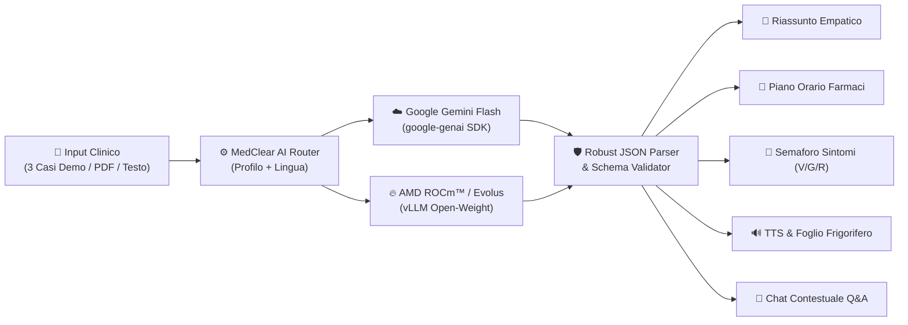

# 🩺 MedClear AI — Dimissioni Chiare

> **Track:** Health & Wellbeing  
> **⚡ Hybrid AI Engine:** AMD ROCm™ (vLLM / Evolus Open-Weight) & Google Gemini Flash (`google-genai`)

**MedClear AI** è una Web App SaaS clinica progettata per **abbattere il gergo medico e le barriere linguistiche** al momento della dimissione ospedaliera o del Pronto Soccorso. Trasforma referti clinici complessi in una guida empatica, strutturata, multilingua e pronta da stampare e attaccare al frigorifero di casa.

---

## 🎯 Il Problema Clinico e Sociale

Oltre il **60% dei pazienti** (e dei caregiver familiari) fatica a comprendere pienamente le istruzioni contenute nelle lettere di dimissione ospedaliera a causa di:
- **Gergo tecnico e sigle mediche** (`HFmrEF`, `FA`, `DOAC`, `EBPM`, `s.c./die`, `SpO2`, `MDI`, `NYHA`).
- **Politerapie complesse** con orari, interazioni e condizioni di sospensione difficili da ricordare.
- **Mancanza di chiarezza sui segnali d'allarme (Red Flags)**: i pazienti non sanno distinguere tra un sintomo normale di guarigione, un motivo per chiamare il medico di base o un'emergenza da Pronto Soccorso.
- **Barriere linguistiche ed età avanzata**.

---

## ✨ Funzionalità Principali

1. **⚡ Architettura AI Ibrida (Dual-Provider: Evolus Cloud on AMD Instinct™ + Gemini Flash)**:
   - **Evolus Cloud / AMD ROCm™ (`evo_...`)**: supporto nativo OpenAI-compatibile (`vLLM` su GPU AMD Instinct™ MI300X ROCm™ 6.2) per deployment ospedalieri *on-premise* e *privacy-preserving* (Zero Data Leakage).
   - **Google Gemini API (`AIza...`)**: integrazione con l'SDK `google-genai` (`gemini-2.5-flash` / `gemini-3.8-flash`) e REST API.
   - **Smart Fallback Zero-Crash**: garantisce che la demo live per i giudici dell'hackathon funzioni istantaneamente in tutte le 13 lingue anche senza chiavi API o in caso di timeout di rete.

2. **🌍 Supporto Nativo per 13 Lingue (Intera UI + Referto + Voce + Chat)**:
   - 🇮🇹 Italiano, 🇬🇧 English, 🇷🇺 Русский (Russian), 🇪🇸 Español, 🇫🇷 Français, 🇩🇪 Deutsch, 🇸🇦 العربية (Arabic con layout **RTL** automatico), 🇨🇳 中文 (Chinese), 🇷🇴 Română, 🇺🇦 Українська, 🇮🇳 हिन्दी (Hindi), 🇵🇹 Português, 🇦🇱 Shqip (Albanian).

3. **🎨 Accessibilità Clinica Universale (WCAG AAA)**:
   - **☀️ Clinico Chiaro**, **🌙 Dark Mode (Riposo Visivo)** e **👁️ Modalità Daltonici (Palette scientifica Okabe-Ito + codifica per forma `● Normale`, `▲ Medico`, `■ Emergenza 112`)** per pazienti con deuteranopia/protanopia.
   - **👓 Carattere Grande (Anziani / Ipovedenti)** attivabile con un click sia dalla Barra di Controllo Rapida che dalla Sidebar.

4. **📥 3 Casi Clinici Ospedalieri Demo + Upload PDF Reale**:
   - **Caso 1 — Cardiologia (UTIC)**: Scompenso cardiaco (`HFmrEF`, FE 45%) e fibrillazione atriale in politerapia (`Bisoprololo`, `Apixaban`, `Furosemide`, `Ramipril`), monitoraggio peso, dieta iposodica ed esami renali/`K+`.
   - **Caso 2 — PS Ortopedia/Traumatologia**: Frattura composta malleolo peroneale (`Weber A`), tutore `Walker`, scarico con stampelle e profilassi antitrombotica sottocute con `Enoxaparina (Clexane)`.
   - **Caso 3 — Dimissione Pediatrica (OBIP)**: Bronchiolite acuta / Broncospasmo in bambino di 18 mesi, terapia inalatoria con `Salbutamolo MDI + distanziatore`, `Betametasone`, lavaggi nasali e monitoraggio frequenza respiratoria (`FR`).
   - **Estrazione PDF con `pypdf`** + analisi automatica della complessità clinica e delle sigle mediche rilevate.

5. **📊 Dashboard Paziente Strutturata & Chat Contestuale**:
   - 💙 **Riassunto Empatico** adattato al **Profilo Paziente** (*Standard Adulto*, *Semplificato Anziano/Caregiver*, *Pediatrico per Genitori*).
   - 💊 **Piano Terapeutico Orario** (*Mattina, Pranzo, Sera, Al Bisogno*) con posologia localizzata.
   - 🚦 **Semaforo dei Sintomi a 3 Colonne** (*Verde / Giallo / Rosso*).
   - 🔊 **Audio-Guida Vocale (TTS)** in 13 lingue + 🖨️ **Foglio Frigorifero Stampabile (`HTML` / `TXT`)**.
   - 💬 **Chat Contestuale ("Chiedi al tuo Referto")** funzionante in tutte le 13 lingue.

---

## 🏗️ Architettura del Sistema



---

## 🚀 Quickstart (Avvio Rapido)

### 1. Clona il repository e crea l'ambiente virtuale

```bash
python3 -m venv .venv
source .venv/bin/activate  # Su Windows: .venv\Scripts\activate
pip install -r requirements.txt
```

### 2. Configura le variabili d'ambiente (Opzionale)

Puoi inserire le API Key direttamente nella **Sidebar dell'interfaccia** oppure esportarle nel terminale:

```bash
# Per Google Gemini Flash
export GEMINI_API_KEY="la-tua-api-key"

# Per AMD ROCm™ / Evolus Cloud (vLLM OpenAI-compatible)
export AMD_ROCM_API_KEY="la-tua-rocm-key"
export ROCM_BASE_URL="https://api.evolus.cloud/v1"
export ROCM_MODEL_NAME="meta-llama/Llama-3.1-8B-Instruct"
```

### 3. Avvia l'applicazione

```bash
streamlit run app.py
```

---

## 📁 Struttura del Progetto

```text
.
├── app.py              # Single-file Streamlit Web App completa (UI SaaS, AI Ibrida, PDF, TTS, Chat)
├── requirements.txt    # Dipendenze Python (streamlit, google-genai, openai, pypdf, requests, gTTS)
└── README.md           # Documentazione tecnica e guida per la demo Hackathon
```

---

## ⚠️ Disclaimer Medico

**MedClear AI** è uno strumento di supporto alla comprensione e all'alfabetizzazione sanitaria realizzato a scopo dimostrativo. Non effettua diagnosi, non modifica le prescrizioni mediche e non sostituisce in alcun modo il parere del Medico di Medicina Generale, dello specialista o del Pronto Soccorso (`112` / `118`).
